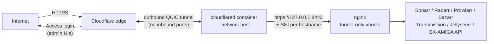

# Cloudflare Tunnel (cloudflared)

Outbound-only tunnel from the Pi to Cloudflare's edge — lets hostnames be served
without port-forwarding on the home router or depending on [ddclient](../ddclient/README.md)
keeping the public IP up to date.

Fronts every public HTTPS service except Jellyfin and dropservice — see
[Routes](#routes). It's a **remotely-managed** tunnel: the tunnel itself, its public hostnames and
where each one routes are all configured in the Cloudflare dashboard
(Zero Trust → Networks → Tunnels). The Pi only holds the connector token; there's
no local `config.yml`.

Runs as a Docker container, same exception to the bare-metal/systemd convention as
[Jellyseerr](../jellyseerr/README.md).

## Architecture



## Install

The token comes from the dashboard (tunnel → Configure → install connector). It's a
secret — keep it out of this repo, it lives only in a root-only env file on the Pi
(see [`tunnel.env.example`](tunnel.env.example)):

```bash
sudo mkdir -p /etc/cloudflared
sudo cp tunnel.env.example /etc/cloudflared/tunnel.env   # then paste the real token in
sudo chmod 600 /etc/cloudflared/tunnel.env

sudo docker pull cloudflare/cloudflared:latest

sudo docker run -d \
  --name cloudflared \
  --restart unless-stopped \
  --network host \
  --env-file /etc/cloudflared/tunnel.env \
  cloudflare/cloudflared:latest tunnel --no-autoupdate run
```

Notes on the flags:

- `--env-file` — cloudflared reads `TUNNEL_TOKEN` from the environment, so the token
  never shows up in `ps`/`docker inspect` command args or shell history (unlike the
  `--token …` form the dashboard suggests).
- `--network host` — the container shares the host's network, so dashboard routes
  can point straight at nginx's local listener (`https://127.0.0.1:8443`) without
  any `host.docker.internal` juggling.
- `--restart unless-stopped` — comes back on boot (the `docker` service is enabled)
  and after crashes; only an explicit `docker stop` keeps it down.
- `--no-autoupdate` — the container image is the update mechanism, see below.

## Routes

Configured in the dashboard (Networks → Tunnels → this tunnel → Public Hostnames /
Published application routes) — cloudflared picks up changes live, no restart. Every
route points at **nginx**, never at an app directly, so TLS, rate limiting and
logging stay in one place:

| Hostname | Service | Origin Server Name | Cloudflare Access |
|---|---|---|---|
| sonarr.sillyash.com | `https://127.0.0.1:8443` | sonarr.sillyash.com | `homelab-admin` |
| radarr.sillyash.com | `https://127.0.0.1:8443` | radarr.sillyash.com | `homelab-admin` |
| prowlarr.sillyash.com | `https://127.0.0.1:8443` | prowlarr.sillyash.com | `homelab-admin` |
| bazarr.sillyash.com | `https://127.0.0.1:8443` | bazarr.sillyash.com | `homelab-admin` |
| transmission.sillyash.com | `https://127.0.0.1:8443` | transmission.sillyash.com | `homelab-admin` |
| jellyseerr.sillyash.com | `https://127.0.0.1:8443` | jellyseerr.sillyash.com | — (public, own login) |
| api.examigaband.com | `https://127.0.0.1:8443` | api.examigaband.com | — (public API) |

- **`127.0.0.1`, not `localhost`** — nginx's tunnel listener is IPv4-only;
  `localhost` can resolve to `::1` first.
- **Origin Server Name is required** — it's the SNI cloudflared sends, so nginx
  picks the right vhost/cert and verification passes (leave *No TLS Verify* off).
- **`:8443` is local-only** — see [nginx](../nginx/README.md#two-front-doors-public-443-vs-tunnel-only-8443).
  The tunneled vhosts don't listen on public `:443` at all, so Access can't be
  bypassed by hitting the home IP.
- **Not tunneled:** `jelly.sillyash.com` (Cloudflare's ToS restricts video through
  their proxy), `drop.sillyash.com` (100 MB request-body cap on the Free plan) and
  `ssh.sillyash.com` (port 22, would need `cloudflared` on every client). Those stay
  on [ddclient](../ddclient/README.md)-managed A records + router port-forwards
  (443, 22; port 80 is closed).

Adding a hostname: remove it from ddclient's list → delete its A record → add the
route (which creates the proxied CNAME) → add the nginx vhost with
`listen 127.0.0.1:8443 ssl;` only.

## Cloudflare Access

Zero Trust → Access → Applications → **`homelab-admin`** (self-hosted), covering
sonarr, radarr, prowlarr, bazarr and transmission:

- Policy **Allow**, Include → Emails → the owner's address(es).
- Login method **One-time PIN** only (selected explicitly rather than "accept all",
  so a provider added later doesn't silently become valid), instant auth on.
- Session 24h. App logins still apply behind it — Access is an extra layer.

Apps that talk to each other (Jellyseerr → Sonarr/Radarr, Prowlarr → *arr, Bazarr
→ *arr) use `localhost` / `host.docker.internal`, not the public hostnames, so
Access doesn't get in their way. A mobile client pointed at a public admin hostname
*will* hit the Access login (even on the LAN — the hostnames resolve to Cloudflare
everywhere); give it an Access service token, or point it at `http://<pi-lan-ip>:<port>`.

[`snippets/cloudflare-access.conf`](../nginx/snippets/cloudflare-access.conf) on the
nginx side catches Access's `/cdn-cgi/access/authorized` callback when it leaks
through to the origin (otherwise the app shows its 404/login page right after the
Access login).

## Updating

```bash
sudo docker pull cloudflare/cloudflared:latest
sudo docker rm -f cloudflared
# then re-run the `docker run` command from Install
```

## Rotating the token

Dashboard → tunnel → Configure → **Refresh token**, paste the new value into
`/etc/cloudflared/tunnel.env`, then recreate the container (`docker restart` doesn't
re-read `--env-file`).

## Useful commands

```bash
sudo docker ps --filter name=cloudflared       # running?
sudo docker logs cloudflared -f                # follow logs ("Registered tunnel connection" ×4 = healthy)
sudo docker restart cloudflared                # reconnect
```
