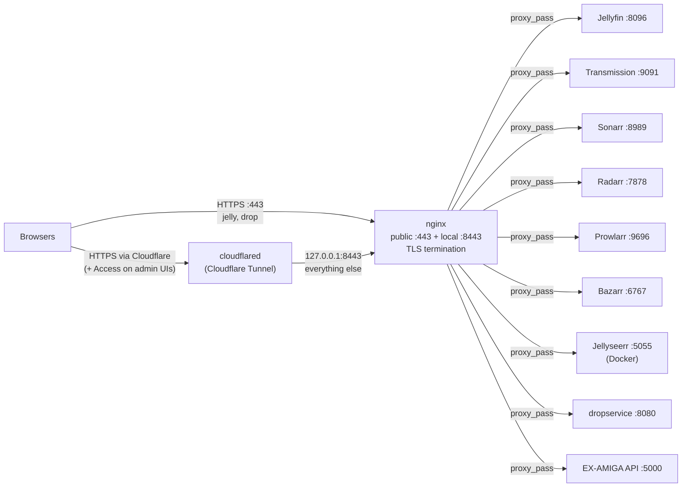

# nginx

Single reverse proxy / TLS termination point for every HTTPS service on the box.
Installed from the Debian repos (`apt install nginx`), config lives under
`/etc/nginx/`. Each virtual host is a file in `sites-available/`, symlinked into
`sites-enabled/`.

## Vhosts

| Host | Symlink name | Listens on | Proxies to | Cert |
|---|---|---|---|---|
| `jelly.sillyash.com` | `jellyfin` | public `:443` | `localhost:8096` (Jellyfin) | `jelly.sillyash.com` |
| `drop.sillyash.com` | `drop` | public `:443` | `127.0.0.1:8080` (dropservice) | `drop.sillyash.com` |
| `transmission.sillyash.com` | `jellyfin` (same file, second `server{}` block) | `127.0.0.1:8443` (tunnel) | `localhost:9091` (Transmission) | `jelly.sillyash.com` |
| `sonarr.sillyash.com` | `arr-stack` | `127.0.0.1:8443` (tunnel) | `localhost:8989` (Sonarr) | `jelly.sillyash.com` |
| `radarr.sillyash.com` | `arr-stack` (same file) | `127.0.0.1:8443` (tunnel) | `localhost:7878` (Radarr) | `jelly.sillyash.com` |
| `prowlarr.sillyash.com` | `arr-stack` (same file) | `127.0.0.1:8443` (tunnel) | `localhost:9696` (Prowlarr) | `jelly.sillyash.com` |
| `bazarr.sillyash.com` | `arr-stack` (same file) | `127.0.0.1:8443` (tunnel) | `localhost:6767` (Bazarr) | `jelly.sillyash.com` |
| `jellyseerr.sillyash.com` | `jellyseerr` | `127.0.0.1:8443` (tunnel) | `127.0.0.1:5055` (Jellyseerr, Docker) | `jelly.sillyash.com` |
| `api.examigaband.com` | `examiga` | `127.0.0.1:8443` (tunnel) | `127.0.0.1:5000` (EX-AMIGA API, gunicorn) | `api.examigaband.com` |

All terminate TLS with certs from [certbot](../certbot/README.md). The
`jelly.sillyash.com` cert covers every `sillyash.com` host above except `drop` as
SANs (one cert, one renewal, one nginx reload).

### Two front doors: public `:443` vs tunnel-only `:8443`

Only **Jellyfin** and **dropservice** are served directly on public `:443` (router
port-forward) — Jellyfin because streaming video through Cloudflare's proxy is
against their ToS, drop because Cloudflare caps proxied uploads at 100 MB. Port 80
is no longer forwarded; the `listen 80` redirects that remain on those two vhosts
only matter on the LAN.

Every other vhost listens **only** on `127.0.0.1:8443`, which is where the
[Cloudflare Tunnel](../cloudflared/README.md) routes point. That's what makes
Cloudflare Access unskippable: aiming `Host: sonarr.sillyash.com` at the home IP
doesn't reach Sonarr, because nothing on public `:443` answers to that name.
[`conf.d/default-reject.conf`](conf.d/default-reject.conf) is the public `:443`
`default_server` and refuses the TLS handshake (`ssl_reject_handshake on`) for any
SNI that isn't jelly or drop, so those attempts (and bare-IP scans) get nothing.

## Architecture



## Files in this repo

- [`sites-available/drop`](sites-available/drop) — real vhost for dropservice.
- [`sites-available/jellyfin`](sites-available/jellyfin) — real vhost for both
  Jellyfin and Transmission (they share the same Let's Encrypt cert since it covers
  both hostnames as SANs). The Transmission `server{}` block also applies rate
  limiting — see below.
- [`sites-available/arr-stack`](sites-available/arr-stack) — real vhost for
  Sonarr, Radarr, Prowlarr, and Bazarr (one file, four `server{}` blocks). Each
  app's `/login` (or, for Bazarr, `/api/system/account`) path gets nginx rate
  limiting, and the whole vhost logs to a separate
  `/var/log/nginx/arr-access.log` using a custom format (see
  [`conf.d/log-formats.conf`](conf.d/log-formats.conf)) so
  [fail2ban](../fail2ban/README.md) could see failed logins that come back as a 302
  redirect rather than a 401 (that jail is now disabled — these hosts sit behind
  Cloudflare Access instead — but the log is still handy).
- [`sites-available/jellyseerr`](sites-available/jellyseerr) — real vhost for
  Jellyseerr (Docker container, proxied like any other localhost-bound service).
- [`conf.d/cloudflared-realip.conf`](conf.d/cloudflared-realip.conf) — trusts
  `CF-Connecting-IP` from `127.0.0.1` only (cloudflared), so `$remote_addr` is the
  real client in logs, `X-Real-IP` and the `limit_req` zones — without it every
  tunneled visitor would share one 127.0.0.1 rate-limit bucket.
- [`conf.d/default-reject.conf`](conf.d/default-reject.conf) — public `:443`
  catch-all that rejects the TLS handshake for unknown hostnames (see above).
- [`snippets/cloudflare-access.conf`](snippets/cloudflare-access.conf) — included
  in the Access-protected vhosts (arr-stack, Transmission). Cloudflare Access's
  `/cdn-cgi/access/authorized` login callback sometimes gets forwarded to the
  origin, where the app would 404 or bounce it through its own login; anything
  reaching nginx has already passed Access, so it just redirects to `/`.
- [`conf.d/rate-limit.conf`](conf.d/rate-limit.conf) — `limit_req_zone`/
  `limit_conn_zone` definitions (must live in the `http{}` context, so they're a
  separate `conf.d/` file rather than inline in the vhost) used to throttle bots
  hitting [Transmission's public login](../transmission/README.md) and the
  arr-stack apps' login endpoints.
- [`conf.d/log-formats.conf`](conf.d/log-formats.conf) — the `arr_auth` log format
  used by the arr-stack vhost; captures the response's `Location` header
  (`$sent_http_location`) since Sonarr/Radarr/Prowlarr answer bad credentials with
  a 302 to `/login?...&loginFailed=true` rather than a 401.

To deploy: copy `sites-available/*` into `/etc/nginx/sites-available/` (symlinked
into `sites-enabled/`), `conf.d/*` into `/etc/nginx/conf.d/` and `snippets/*` into
`/etc/nginx/snippets/`, then `nginx -t && systemctl reload nginx`.

## Useful commands

```bash
sudo nginx -t                              # validate config syntax before reloading — always do this first
sudo systemctl reload nginx                # apply config changes without dropping connections
sudo systemctl restart nginx               # full restart (only if reload isn't enough)
systemctl status nginx                     # running? recent errors?
sudo tail -f /var/log/nginx/access.log     # live requests, all vhosts
sudo tail -f /var/log/nginx/error.log      # live errors (bad proxy_pass, cert issues, etc.)

# test a tunneled vhost locally, the way cloudflared reaches it
curl --resolve sonarr.sillyash.com:8443:127.0.0.1 https://sonarr.sillyash.com:8443/

# enable/disable a vhost
sudo ln -s /etc/nginx/sites-available/<name> /etc/nginx/sites-enabled/<name>
sudo rm /etc/nginx/sites-enabled/<name>
ls -la /etc/nginx/sites-enabled/           # what's currently live
```
