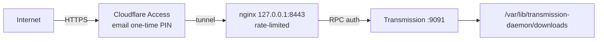

# Transmission

BitTorrent client, web UI reachable at `https://transmission.sillyash.com` via the
[nginx](../nginx/README.md) reverse proxy (nginx handles TLS; the daemon itself
listens on plain HTTP on `9091`).

> **Exposure:** Cloudflare Tunnel + Access — no longer on public `:443`; nginx serves it on `127.0.0.1:8443` for cloudflared only. See [cloudflared](../cloudflared/README.md).

## Architecture



Reachable remotely so torrents can be added from anywhere. The RPC login prompt
used to be probed by bots constantly; it's now layered:

- **[Cloudflare Access](../cloudflared/README.md#cloudflare-access)** in front —
  bots never reach the prompt without passing the email one-time PIN first.

- **nginx rate limiting** ([`conf.d/rate-limit.conf`](../nginx/conf.d/rate-limit.conf),
  applied in the `transmission.sillyash.com` server block in
  [`sites-available/jellyfin`](../nginx/sites-available/jellyfin)): `5r/m` per IP with
  a burst of 5, plus a cap of 5 concurrent connections per IP. Throttles bots before
  they even reach Transmission; a human occasionally logging in to add a torrent is
  unaffected.
- **[fail2ban](../fail2ban/README.md)'s `transmission-rpc` jail** used to ban IPs
  after repeated 401s; it's **disabled** since the tunnel, because traffic now
  arrives from cloudflared on localhost and a firewall ban can't touch it.

## Install

```bash
apt install transmission-daemon
```

Runs as the dedicated `debian-transmission` system user. Package-stock systemd unit,
no local overrides.

```bash
systemctl enable --now transmission-daemon
```

## Config

`/etc/transmission-daemon/settings.json` (mode `600`, owned by
`debian-transmission` — not committed, contains the RPC password hash). Relevant
non-secret settings currently in effect:

| Key | Value | Note |
|---|---|---|
| `download-dir` | `/var/lib/transmission-daemon/downloads` | stock default |
| `rpc-port` | `9091` | proxied by nginx |
| `rpc-bind-address` | `0.0.0.0` | exposed on all interfaces, but... |
| `rpc-authentication-required` | `true` | ...login is required, and nginx puts TLS in front of it |
| `rpc-whitelist-enabled` | `false` | IP whitelist off — relying on auth + TLS instead |

The RPC credentials are also used by [Sonarr](../sonarr/README.md) and
[Radarr](../radarr/README.md) as their download-client login (username `arrstack`,
rotated to a freshly generated password when they were wired up — stored in
`/root/.arr-api-keys` on the Pi, not committed).

Set/change the RPC username & password:

```bash
systemctl stop transmission-daemon
# edit rpc-username / rpc-password in settings.json, or use transmission-remote
systemctl start transmission-daemon
```

## Useful commands

```bash
sudo systemctl restart transmission-daemon   # apply a settings.json change (must be stopped while editing, see above)
systemctl status transmission-daemon         # running?
journalctl -u transmission-daemon -n 50 --no-pager

# transmission-remote — CLI client, talks to the same RPC endpoint the web UI uses
transmission-remote localhost:9091 --auth <user>:<pass> -l              # list torrents
transmission-remote localhost:9091 --auth <user>:<pass> -a "<magnet-or-.torrent-url>"  # add a torrent
transmission-remote localhost:9091 --auth <user>:<pass> -t <id> -S      # stop a torrent
transmission-remote localhost:9091 --auth <user>:<pass> -t <id> --info  # details on one torrent
```
